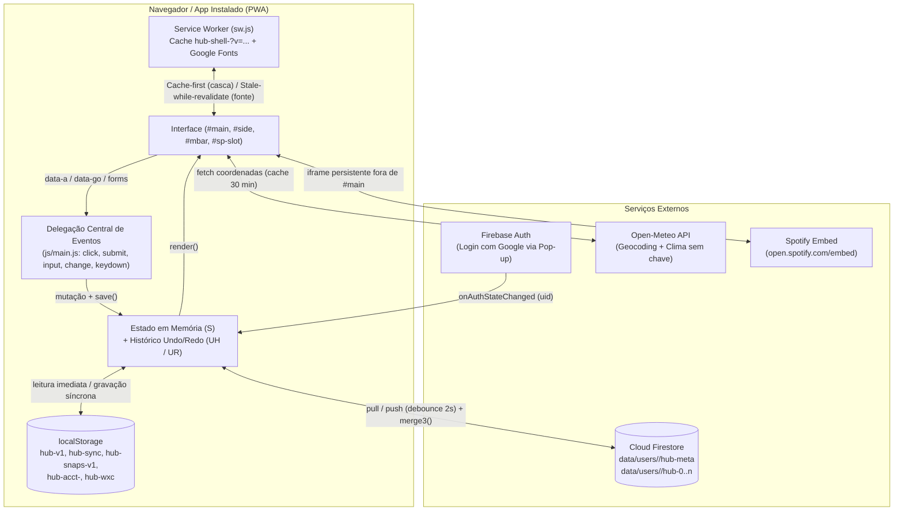
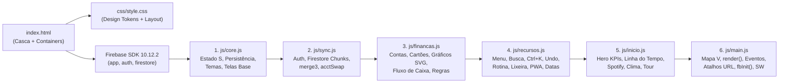
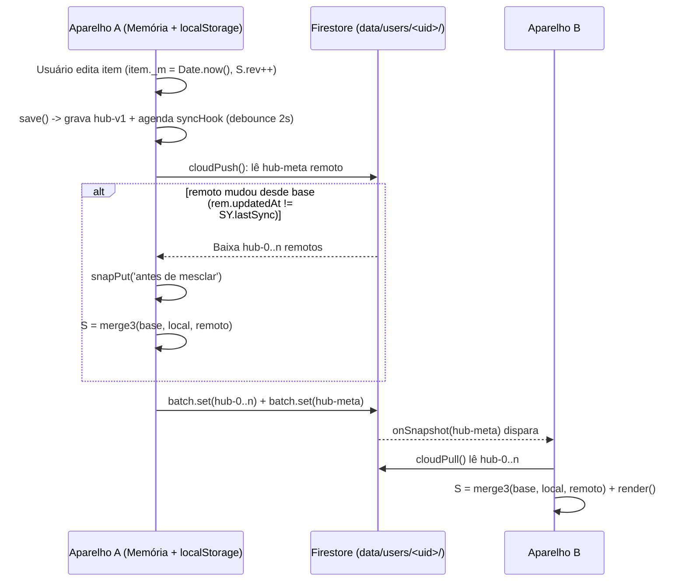
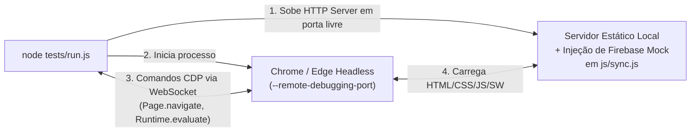

# Arquitetura do Projeto — Meu Hub

Este documento descreve como o **Meu Hub** é construído por dentro: a divisão de arquivos, a ordem de carregamento, o modelo de dados (`S`), o ciclo de renderização e eventos, o motor de sincronização e mescla de três vias (`merge3`), o funcionamento offline como PWA e a arquitetura da suíte de testes ponta a ponta.

---

## 1. Visão Geral e Filosofia Técnica

O Meu Hub segue uma arquitetura **zero-build, local-first e sem dependências de execução (zero-npm)**:

- **Sem etapa de compilação:** os arquivos `.html`, `.css` e `.js` da pasta raiz são servidos exatamente como estão pelo GitHub Pages (`https://vitoriapac.github.io/MeuHub/`) ou por qualquer servidor estático local (`python -m http.server 8080`).
- **Scripts clássicos em escopo global compartilhado:** em vez de bundlers ou ES Modules (`import`/`export`), os 6 arquivos JavaScript são carregados em sequência determinística no `index.html`. Símbolos globais curtos (`S`, `V`, `PAL`, `render`, `save`, `$`, `esc`, `toast`) funcionam como a API interna entre os módulos.
- **Local-first com sincronização em nuvem:** toda leitura e escrita da interface acontece instantaneamente sobre o objeto em memória `S` e no `localStorage` (`hub-v1`). O Firebase Firestore atua como camada de replicação assíncrona em segundo plano, com mescla automática item a item (`merge3`).
- **Isolamento rigoroso entre contas:** cada conta Google lê e grava apenas em `data/users/<uid>/` no Firestore, e a troca de usuário no mesmo navegador isola o estado local em `hub-acct-<uid>`.

---

## 2. Mapa de Arquivos e Ordem de Carregamento

A ordem dos `<script defer src="...?v=...">` no [`index.html`](file:///c:/Users/vitor/Documents/MeuHub/index.html) faz parte do contrato arquitetural:

| Arquivo | Linhas aprox. | Papel arquitetural e principais símbolos exportados no escopo global |
|---|---:|---|
| [`index.html`](file:///c:/Users/vitor/Documents/MeuHub/index.html) | 109 | Casca HTML semântica: tela de bloqueio (`#gate`), barra lateral/topo (`#side`), barra inferior mobile (`#mbar`), palco principal (`#main`), slot persistente do Spotify (`#sp-slot`), container de modais (`#mroot`) e região `aria-live` (`#toast`). |
| [`manifest.webmanifest`](file:///c:/Users/vitor/Documents/MeuHub/manifest.webmanifest) | 40 | Metadados PWA (`display: standalone`, `lang: pt-BR`, ícones 192/512/maskable e 4 atalhos de ação rápida). |
| [`sw.js`](file:///c:/Users/vitor/Documents/MeuHub/sw.js) | 50 | Service Worker: precache da casca na versão `VER`, limpeza de caches antigos no `activate`, cache de fontes e suporte a notificações do sistema. |
| [`css/style.css`](file:///c:/Users/vitor/Documents/MeuHub/css/style.css) | 380 | Sistema visual completo baseado em custom properties (`--bg`, `--card`, `--ink`, `--p`, `--s1`, `--s2`, `--s3`, `--s4`), suporte a tema claro/escuro (`[data-theme="dark"]`), alto contraste (`[data-hc="1"]`), redução de movimento (`[data-rm="1"]`), responsivo mobile (`@media (max-width:780px)`) e folha de impressão (`@media print`). |
| [`js/core.js`](file:///c:/Users/vitor/Documents/MeuHub/js/core.js) | 442 | Utilitários base (`$`, `$$`, `esc`, `uid`, `td`, `fd`, `fm`, `toast`), estado global `S`, `DEF()`, `migrate()`, `load()`, `save()`, paletas `PAL`, `applyTheme()`, Pomodoro (`tickPomo`, `drawPomo`), lembretes (`remind`) e views fundamentais (`dash`, `agenda`, `notas`, `tarefas`, `links`, `backup`, `aparencia`, `habitos`, `diario`, `hoje`, `etiquetas`, `metas`). |
| [`js/sync.js`](file:///c:/Users/vitor/Documents/MeuHub/js/sync.js) | 119 | Configuração `FB_CONFIG`, inicialização do Firebase (`fbInit`), tela de login (`gateShow`, `gateR`), isolamento entre contas (`acctSwap`), motor de mescla de 3 vias (`merge3`, `mergeArr`), fragmentação em blocos de 300k chars (`chunks`) e sincronização em tempo real (`cloudPull`, `cloudPush`, `syncHook`). |
| [`js/financas.js`](file:///c:/Users/vitor/Documents/MeuHub/js/financas.js) | 503 | Motor financeiro: migração `migFin`, recorrências do mês (`genRec0`), cálculo de faturas de cartão (`invoice`), dicionário de categorização (`CATDIC`, `autoCat`, `ruleHit`), parser de linguagem natural (`parseNL`) e CSV (`parseCSV`), gráficos SVG puros (`barsSvg`, `donut`, `gauge`, `lineChart`, `waterSvg`, `cashSvg`), projeção de fluxo de caixa 30/60/90d (`cashFlow`), reserva de emergência (`reservaPanel`), divisão de despesas (`splitPanel`) e relatório anual (`relAnual`). |
| [`js/recursos.js`](file:///c:/Users/vitor/Documents/MeuHub/js/recursos.js) | 434 | Roteador das 6 abas de Finanças (`FTABS`, `financas2`), captura rápida (`qa`), busca global (`busca`), histórico Undo/Redo (`UH`, `UR`, `track`, `undo`, `redo`), menu personalizável (`menuCfg`, `renderMenu`, `menuView`), acessibilidade (`a11y`, `applyA11y`), instalação PWA (`pwaPanel`, `pwaInstall`), lixeira com retenção de 30 dias (`TRC`, `delItem`, `trashSweep`), alertas de atenção (`attention`, `digest`), carga do dia (`dayLoad`, `autoSlot`), rotina guiada (`rotina`), conexões bidirecionais (`lkSet`, `lkDraw`), leituras (`leituras`), comando rápido `Ctrl+K` (`ckOpen`), modo privacidade (`PRIV`, `togglePriv`), versões locais (`snaps`, `snapPut`) e máscara de data brasileira (`dtUp`). |
| [`js/inicio.js`](file:///c:/Users/vitor/Documents/MeuHub/js/inicio.js) | 182 | Painel inicial modular: resumo Hero com anel SVG e sparkline de 7 dias (`heroCard`, `kRing`, `kSpark`, `kTrend`), linha do tempo interativa (`lineCard`), player persistente do Spotify (`spCard`, `spSync`), clima Open-Meteo com cache (`wxCard`, `wxLoad`), frase do dia (`frCard`), tour guiado (`tourOpen`) e gerador/removedor de dados de exemplo (`exLoad`, `exClear`). |
| [`js/main.js`](file:///c:/Users/vitor/Documents/MeuHub/js/main.js) | 209 | Paginação incremental (`PG`, `pgSlice`, `pgMore`), tabela de roteamento `V` (18 telas), função central `render()`, delegação global de eventos (`click`, `change`, `input`, `submit`), tratamento de parâmetros de URL (`?v=`, `?qa=`), disparo de `fbInit()` e registro do `sw.js`. |
| [`tests/run.js`](file:///c:/Users/vitor/Documents/MeuHub/tests/run.js) | 435 | Executor de testes E2E sem dependências externas: sobe servidor HTTP local com Firebase mockado e controla o Chrome/Edge headless via WebSocket (Chrome DevTools Protocol). |

### Regra de dependência entre arquivos
Como todos os arquivos compartilham o escopo global:
1. Qualquer função pode referenciar símbolos de arquivos carregados **depois** dela, **desde que** essa referência só seja executada em tempo de interação ou renderização (ex.: `core.js` chama `render()` ou `track()` dentro de funções).
2. Qualquer código executado **imediatamente durante o carregamento** que dependa de símbolos de outros arquivos deve ficar no final do [`js/main.js`](file:///c:/Users/vitor/Documents/MeuHub/js/main.js).

---

## 3. Modelo de Dados e Armazenamento Local

### 3.1. O Objeto de Estado `S`
Todo o conteúdo do usuário vive em um único objeto JSON serializável chamado `S` (inicializado por [`DEF()`](file:///c:/Users/vitor/Documents/MeuHub/js/core.js#L18-L24) e evoluído sem quebrar versões antigas por [`migrate()`](file:///c:/Users/vitor/Documents/MeuHub/js/core.js#L26-L31) e [`migFin()`](file:///c:/Users/vitor/Documents/MeuHub/js/financas.js#L9-L17)):

| Chave em `S` | Tipo | Descrição |
|---|---|---|
| `name` | `string` | Nome de exibição nos cumprimentos do Início (`"meu hub"` por padrão). |
| `theme` | `'light' \| 'dark'` | Tema visual ativo. |
| `pal` | `string` | Paleta de cores ativa (`'ceu'`, `'ametista'`, `'safira'`, `'floresta'`, `'citrico'`). |
| `view` | `string` | Tela ativa no momento (`'dash'`, `'hoje'`, `'financas'`, etc.). |
| `cards` | `string[]` | Lista de IDs dos cards visíveis na tela **Início** (padrão focado: `['linha','todo','agenda','habs','fin']`). |
| `cardOrder` | `string[]` | Ordem personalizada de exibição dos cards no **Início** (15 cards disponíveis). |
| `menuOrder` | `string[]` | Ordem personalizada das 18 telas no menu lateral e barra mobile. |
| `menuHide` | `string[]` | IDs das telas ocultadas do menu principal (acessíveis via `Mais telas`). |
| `a11y` | `object` | Preferências de acessibilidade: `{ keys: boolean, hc: boolean, rm: boolean }`. |
| `todos` | `Array<Todo>` | Tarefas (`{ id, txt, pri, done, due, time, dur, rec, tags, sub, note, doneAt, _m }`). |
| `events` | `Array<Event>` | Compromissos da agenda (`{ id, date, time, dur, end, title, loc, cat, rec, tags, _m }`). |
| `notes` | `Array<Note>` | Notas com suporte a marcação simples, cor, fixação (`pin`), arquivo (`arch`) e checklist (`items`). |
| `links` | `Array<Link>` | Atalhos/favoritos (`{ id, title, url, cat, icon, tags, _m }`). |
| `habits` | `Array<Habit>` | Hábitos diários (`{ id, name, icon, days: { 'AAAA-MM-DD': true }, _m }`). |
| `fin` | `Array<FinTx>` | Lançamentos financeiros (`{ id, type, desc, cat, val, date, acc, card, paid, fix, parN, parI, splitWith, splitPct, splitPaid, tags, _m }`). |
| `finAcc` | `Array<Account>` | Contas bancárias/carteiras (`{ id, name, type: 'cc'|'cash'|'inv', init, color, _m }`). |
| `finCards` | `Array<Card>` | Cartões de crédito (`{ id, name, lim, close, due, color, _m }`). |
| `finRec` | `Array<RecTx>` | Despesas/receitas recorrentes mensais que geram itens em `fin` automaticamente via `genRec0()`. |
| `finRules` | `Array<Rule>` | Regras personalizadas de categorização automática (`{ id, match, cat, type, acc }`). |
| `finArch` | `string[]` | Meses (`'AAAA-MM'`) fechados/arquivados contra edição acidental. |
| `budgets` | `Object<cat, val>` | Tetos mensais de gastos por categoria (`{ Alimentação: 800, _m: ... }`). |
| `pctRule` | `object` | Regra percentual de orçamento (`{ ess: 50, est: 30, inv: 20 }`). |
| `savGoals` | `Array<SavGoal>` | Caixinhas/metas de economia financeira (`{ id, title, target, saved, due, hist, _m }`). |
| `reserva` | `object` | Configuração da reserva de emergência (`{ months, saved, accId, mode, manualBase }`). |
| `moods` | `Object<date, Mood>` | Humor diário (`{ 'AAAA-MM-DD': { v: 1..5, note, _m } }`). |
| `diary` | `Array<Diary>` | Entradas de diário com perguntas guiadas (`{ id, date, txt, p1, p2, p3, mood, tags, _m }`). |
| `goals` | `Array<Goal>` | Metas pessoais com marcos (`{ id, title, area, due, prog, done, steps, _m }`). |
| `books` | `Array<Book>` | Leituras, cursos, filmes e séries (`{ id, title, author, kind, status, cur, total, rate, notes, _m }`). |
| `routine` | `object` | Passos e histórico de conclusão da rotina da manhã e da noite (`{ m, n, log }`). |
| `links2` | `Array<[a, b]>` | Conexões bidirecionais entre quaisquer dois itens do hub (`['todos:id1', 'notes:id2']`). |
| `trash` | `Array<TrashItem>` | Lixeira com retenção de 30 dias (`{ id, col, exp, item }`). |
| `pomo` | `object` | Estatísticas do timer Pomodoro (`{ today, date, total, log }`). |
| `spotify` | `string` | URL de embed do Spotify configurado pelo usuário (`open.spotify.com/embed/...`). |
| `wx` | `object` | Cidade e coordenadas selecionadas para o card de Clima (`{ city, lat, lon }`). |
| `rev` | `number` | Contador monotônico incrementado a cada `save()`, usado pelo motor de sincronização e snapshots. |

### 3.2. Chaves do `localStorage`

| Chave | Conteúdo | Escopo |
|---|---|---|
| `hub-v1` | JSON completo do estado `S` da conta ativa. | Por conta (trocado via `acctSwap`). |
| `hub-sync` | Metadados de sincronização (`{ uid, email, name, lastSync, base: <JSON do último S sincronizado> }`). | Por conta (trocado via `acctSwap`). |
| `hub-snaps-v1` | Até 8 snapshots automáticos locais (`[{ rev, ts, note, data }]`) criados a cada ≥ 5 min ou antes de mesclas/importações. | Por conta (trocado via `acctSwap`). |
| `hub-acct-<uid>` | Backup local congelado de `[hub-v1, hub-sync, hub-snaps-v1]` quando outra pessoa faz login no mesmo navegador. | Persistente por `uid`. |
| `hub-wxc` | Cache de 30 minutos da resposta meteorológica do Open-Meteo (`{ key, ts, cur, d }`). | Global do navegador. |

---

## 4. Ciclo de Renderização e Delegação de Eventos

### 4.1. Pipeline de Renderização (`render()`)
O Meu Hub usa re-renderização declarativa direta via template strings:

1. [`render()`](file:///c:/Users/vitor/Documents/MeuHub/js/main.js#L15-L27) verifica se a visão atual `S.view` existe no mapa de roteamento `V` (18 views).
2. Antes de substituir o DOM de `#main`, captura os `scrollTop` dos elementos internos com rolagem (`.scr`) para preservá-los após a atualização.
3. Executa `(V[S.view] || V.dash)()` e injeta o HTML resultante em `#main.innerHTML`.
4. Atualiza o estado ativo dos botões na barra lateral (`#nav`) e na barra inferior mobile (`#mbar`).
5. Desenha o anel do Pomodoro se a tela possuir `#pomo-ring` e sincroniza o slot persistente do Spotify via [`spSync()`](file:///c:/Users/vitor/Documents/MeuHub/js/inicio.js#L69-L79).
6. Um `MutationObserver` em `#main` e `#mroot` dispara [`dtUp()`](file:///c:/Users/vitor/Documents/MeuHub/js/recursos.js#L422-L433) para enriquecer campos `<input type="date">` com máscara brasileira `dd/mm/aaaa` + calendário nativo.

### 4.2. O Slot Persistente do Spotify (`#sp-slot`)
Se o `<iframe>` do Spotify ficasse dentro de `#main`, qualquer chamada a `render()` (ex.: marcar uma tarefa como concluída) recriaria o iframe e interromperia a música.
- **Solução arquitetural:** o iframe vive em `#sp-slot`, **fora** de `#main`.
- Na tela **Início**, o card do Spotify renderiza apenas um placeholder vazio (`#sp-anchor`).
- A função [`spSync()`](file:///c:/Users/vitor/Documents/MeuHub/js/inicio.js#L69-L79) usa `ResizeObserver` e `getBoundingClientRect()` para posicionar `#sp-slot` exatamente sobre `#sp-anchor` quando o usuário está no Início, ou recolhê-lo em uma miniatura flutuante (`class="float"`) no canto inferior direito quando navega para outras telas.

### 4.3. Delegação Central de Eventos e Undo Automático
Em vez de espalhar `onclick` ou dezenas de listeners individuais:
- Toda ação de clique usa o atributo `data-a="<acao>"` (e `data-id`, `data-col`, etc.) tratado pelo listener central em [`js/main.js`](file:///c:/Users/vitor/Documents/MeuHub/js/main.js#L29-L133).
- Antes de executar qualquer ação que modifica dados (qualquer `data-a` que não seja puramente de navegação/visualização e qualquer `submit`), [`track(a)`](file:///c:/Users/vitor/Documents/MeuHub/js/recursos.js#L168-L172) empilha uma cópia serializada do estado anterior na pilha `UH` (até 30 níveis) e limpa a pilha de refazer `UR`.
- Toda função que altera `S` carimba `item._m = Date.now()` no item modificado e chama [`save()`](file:///c:/Users/vitor/Documents/MeuHub/js/core.js#L37-L38), que incrementa `S.rev`, grava em `localStorage`, atualiza snapshots (`snapPut`) e agenda o envio para a nuvem (`syncHook`).

---

## 5. Sincronização em Nuvem e Mescla de 3 Vias (`merge3`)

O módulo [`js/sync.js`](file:///c:/Users/vitor/Documents/MeuHub/js/sync.js) resolve três desafios clássicos de aplicativos local-first: limite de tamanho de documento no Firestore, conflitos de edição simultânea em múltiplos aparelhos e proteção de contas no mesmo navegador.

### 5.1. Fragmentação Segura em Pedaços (`chunks`)
O Firestore impõe limite de 1 MiB por documento. Para suportar anos de diário, notas e finanças sem falhar:
- O JSON do estado `S` é dividido em blocos de até `CH = 300.000` caracteres (`hub-0`, `hub-1`, ...) gravados em um único `writeBatch` atômico junto com o documento leve `hub-meta` (`{ rev, n, updatedAt, by }`).
- A função [`chunks(str)`](file:///c:/Users/vitor/Documents/MeuHub/js/sync.js#L71-L74) verifica se o ponto de corte cai em um **high surrogate UTF-16** (`0xD800`–`0xDBFF`). Se cair, recua 1 unidade de código para nunca partir um emoji de 4 bytes ao meio (testado no Cenário 7).
- O listener em tempo real (`onSnapshot`) escuta **apenas** o documento leve `hub-meta`, economizando leituras da cota gratuita do Firestore.

### 5.2. Algoritmo de Mescla de Três Vias (`merge3`)
Quando dois aparelhos editam o hub antes de sincronizar, [`merge3(base, loc, rem)`](file:///c:/Users/vitor/Documents/MeuHub/js/sync.js#L44-L70) compara o estado **Local (`loc`)**, o estado **Remoto (`rem`)** e o último ancestral comum sincronizado (**Base (`base`)**, salvo em `hub-sync.base`):

1. **Coleções de itens com `id` (`todos`, `events`, `notes`, `links`, `habits`, `fin`, `finAcc`, `finCards`, `finRec`, `finRules`, `savGoals`, `diary`, `goals`, `books`, `trash`):**
   - Exclusão propagada: se um item existia em `base`, foi removido em `loc` (ou `rem`) e **não** foi editado mais recentemente no outro lado, a exclusão é respeitada.
   - Adição preservada: itens novos criados em qualquer um dos dois lados são mantidos.
   - Conflito no mesmo item: vence a versão com maior carimbo de modificação `_m` (`(l._m || 0) >= (r._m || 0)`).
   - Caso especial de **Hábitos** (`habits`): além de mesclar os metadados do hábito por `_m`, o mapa `days` (`{ 'AAAA-MM-DD': boolean }`) é mesclado **dia a dia** comparando `base.days[d]`, `loc.days[d]` e `rem.days[d]`, para que marcar um hábito hoje no celular e outro ontem no computador preserve ambos.
2. **Mapas por chave (`budgets`, `moods`):** mesclados chave a chave comparando com `base` ou pelo timestamp `_m`.
3. **Pares de conexões (`links2`):** união dos pares adicionados em `loc` e `rem`, subtraindo os pares que existiam em `base` e foram removidos em um dos lados.
4. **Campos escalares (`name`, `theme`, `pal`, `spotify`, `wx`, etc.):** se `loc[k]` não mudou em relação a `base[k]`, aceita a mudança de `rem[k]`; se ambos mudaram, prioriza a escolha local do aparelho ativo.

### 5.3. Isolamento Multi-Conta (`acctSwap`) e Reconexão
- Quando o usuário sai ou entra com outra conta Google (`from !== to`), [`acctSwap(from, to)`](file:///c:/Users/vitor/Documents/MeuHub/js/sync.js#L26-L34) empacota `['hub-v1', 'hub-sync', 'hub-snaps-v1']` da conta anterior em `hub-acct-<from>` e restaura `hub-acct-<to>` (ou inicia um `DEF()` limpo).
- Se o navegador ficar sem internet depois de um login prévio, o app libera o acesso local (`modo sem internet`) e um listener `window.addEventListener('online', ...)` reconecta o Firebase automaticamente assim que a rede volta.

---

## 6. Arquitetura PWA e Funcionamento Offline

O Meu Hub funciona como aplicativo instalável (Android, iOS, Windows, macOS e Linux) através de três peças:

1. **[`manifest.webmanifest`](file:///c:/Users/vitor/Documents/MeuHub/manifest.webmanifest):** define `display: "standalone"`, orientação, cores e 4 atalhos de contexto no ícone do app (`Hoje`, `Nova tarefa`, `Novo gasto`, `Finanças`), que abrem `index.html?v=...` ou `index.html?qa=...` (tratados por [`handleUrlParams()`](file:///c:/Users/vitor/Documents/MeuHub/js/main.js#L186-L197)).
2. **[`sw.js`](file:///c:/Users/vitor/Documents/MeuHub/sw.js):**
   - **Precache versionado (`CACHE = 'hub-shell-' + VER`):** armazena `index.html`, `css/style.css`, os 6 arquivos `js/*.js`, `manifest.webmanifest` e os ícones de `img/`.
   - **Bypass estrito de APIs dinâmicas:** requisições para `googleapis.com`, `gstatic.com`, `firebaseio.com`, `open-meteo.com` e `spotify.com` nunca são interceptadas pelo cache do Service Worker, evitando interferência na autenticação ou nos dados em tempo real.
   - **Cache-first para a casca + fallback de navegação:** permite abrir o app instantaneamente mesmo em modo avião.
3. **Sincronização da barra de status (`theme-color`):** [`applyTheme()`](file:///c:/Users/vitor/Documents/MeuHub/js/core.js#L168-L176) atualiza dinamicamente `<meta name="theme-color">` com a cor `--bg` da paleta e do tema (claro/escuro) ativos.

---

## 7. Segurança e Privacidade

- **Prevenção contra XSS:** toda string proveniente do usuário, de arquivos importados (JSON/CSV) ou de APIs externas passa obrigatoriamente por [`esc(s)`](file:///c:/Users/vitor/Documents/MeuHub/js/core.js#L7) antes de ser interpolada em `innerHTML`. Links externos passam por `safeUrl()` (bloqueando esquemas como `javascript:` ou `data:`).
- **Regras do Firestore:** no servidor, a regra `allow read, write: if request.auth != null && request.auth.uid == uid;` em `/data/users/{uid}/{doc}` garante que nenhuma conta leia ou modifique documentos de outro `uid`.
- **Zero telemetria:** não há Google Analytics, cookies de rastreamento nem pixels de terceiros.
- **Modo Privacidade (`PRIV`):** um clique no botão de olho na barra lateral (ou atalho) aplica `class="priv"` ao `<body>`, borrando saldos, valores em `R$`, notas e textos do diário quando há alguém por perto.

---

## 8. Arquitetura de Testes Automatizados (`tests/run.js`)

O arquivo [`tests/run.js`](file:///c:/Users/vitor/Documents/MeuHub/tests/run.js) implementa um runner ponta a ponta completo usando apenas a biblioteca padrão do Node 24 (`http`, `fs`, `child_process`, `WebSocket`):

1. **Servidor HTTP embutido com injeção de Mock:** entrega todos os arquivos reais do projeto, mas intercepta `js/sync.js` para injetar uma implementação completa em memória/localStorage de `window.firebase` (simulando `auth`, `firestore`, `writeBatch`, `onSnapshot`, latência de rede e falhas offline).
2. **Controle direto via Chrome DevTools Protocol (CDP):** conecta via `WebSocket` nativo ao navegador headless, escuta `Runtime.exceptionThrown` e `Runtime.consoleAPICalled` (qualquer erro de JS ou recurso 404 reprova o teste) e executa **12 cenários de ponta a ponta**:
   - **Cenários 1 a 8:** bloqueio sem login (`#gate`), gravação fragmentada (`hub-meta` + `hub-0`), mescla `merge3` entre dois aparelhos, isolamento na troca de contas `A → B → A`, flush ao sair da conta, modo offline com reconexão posterior, integridade de emojis UTF-16 no `chunks()` e limpeza de legado (`hub-gd`).
   - **Cenário 9:** abertura e renderização das 18 telas do menu, das 6 abas de Finanças, do relatório anual, de todos os 15 cards do Início e da busca global sem erros.
   - **Cenário 10:** auditoria estática de cache-busting (`?v=` idêntico em todos os assets locais e zero arquivos órfãos em `css/` ou `js/`).
   - **Cenário 11:** simulação de rede lenta (atraso escalonado de 700 ms por `<script>`) com e sem login e sem internet.
   - **Cenário 12:** validação completa do PWA (`manifest.webmanifest`, ícones existentes, registro e ativação do `sw.js`, `VER` sincronizado com `?v=`, `<meta name="theme-color">` dinâmico e atalhos de URL `?v=hoje` / `?qa=fin`).
