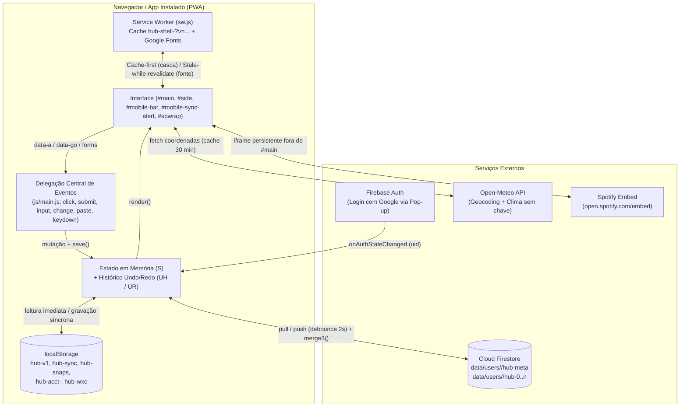
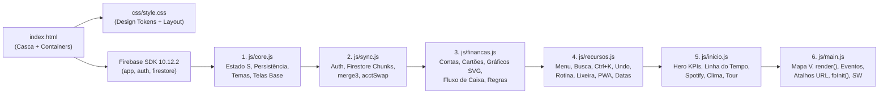
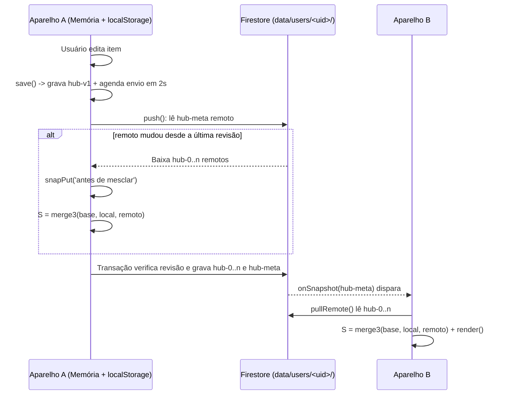
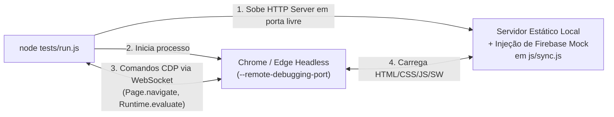

# Arquitetura do Projeto — Meu Hub

Este documento descreve como o **Meu Hub** é construído por dentro: a divisão de arquivos, a ordem de carregamento, o modelo de dados (`S`), o ciclo de renderização e eventos, o motor de sincronização e mescla de três vias (`merge3`), o funcionamento offline como PWA e a arquitetura da suíte de testes ponta a ponta.

---

## 1. Visão Geral e Filosofia Técnica

O Meu Hub segue uma arquitetura **zero-build, local-first e sem dependências de execução (zero-npm)**:

- **Sem etapa de compilação:** os arquivos `.html`, `.css` e `.js` da pasta raiz são servidos exatamente como estão pelo GitHub Pages (`https://vitoriapac.github.io/MeuHub/`) ou por qualquer servidor estático local (`python -m http.server 8080`).
- **Scripts clássicos em escopo global compartilhado:** em vez de bundlers ou ES Modules (`import`/`export`), os 6 arquivos JavaScript são carregados em sequência determinística no `index.html`. Símbolos globais curtos (`S`, `V`, `PAL`, `render`, `save`, `$`, `esc`, `toast`) funcionam como a API interna entre os módulos.
- **Local-first com sincronização em nuvem:** toda leitura e escrita da interface acontece instantaneamente sobre o objeto em memória `S` e no `localStorage` (`hub-v1`). O Firebase Firestore atua como camada de replicação assíncrona em segundo plano, com mescla automática item a item (`merge3`).
- **Isolamento rigoroso entre contas:** cada conta Google lê e grava apenas em `data/users/<uid>/` no Firestore, e a troca de usuário no mesmo navegador isola o estado local em `hub-acct-<uid>`.

---

## 2. Mapa de Arquivos e Ordem de Carregamento

A ordem dos `<script src="...?v=..." defer>` ao final do `<body>` no [`index.html`](file:///c:/Users/vitor/Documents/MeuHub/index.html) faz parte do contrato arquitetural:

| Arquivo | Linhas aprox. | Papel arquitetural e principais símbolos exportados no escopo global |
|---|---:|---|
| [`index.html`](file:///c:/Users/vitor/Documents/MeuHub/index.html) | 41 | Casca HTML semântica: tela de bloqueio (`#gate`), barra lateral (`#side`), barra inferior mobile (`#mobile-bar`), painel `#mobile-menu`, busca global (`.sr`), alerta mobile de sincronização (`#mobile-sync-alert`), palco principal (`#main`), cronômetro (`#pomo`) e região `aria-live` (`#toast`). |
| [`manifest.webmanifest`](file:///c:/Users/vitor/Documents/MeuHub/manifest.webmanifest) | 54 | Metadados PWA (`display: standalone`, `lang: pt-BR`, ícones 192/512/maskable e 5 atalhos de ação rápida: Hoje, Nova tarefa, Novo gasto, Agenda e Finanças). |
| [`sw.js`](file:///c:/Users/vitor/Documents/MeuHub/sw.js) | 53 | Service Worker: precache da casca na versão `VER`, limpeza de caches antigos no `activate`, cache de fontes/capas e suporte a notificações do sistema. |
| [`css/style.css`](file:///c:/Users/vitor/Documents/MeuHub/css/style.css) | 477 | Sistema visual completo baseado em custom properties (`--bg`, `--card`, `--ink`, `--p`, `--s1`..`--s4`, `--mood-2`, `--pos`, `--tag-bg`, `--chart-5`..`--chart-8`), suporte a tema claro/escuro (`[data-theme="dark"]`), alto contraste (`[data-hc="1"]`), redução de movimento (`[data-rmo="1"]`), modo privacidade (`html[data-priv="1"]`), responsivo mobile (`@media (max-width:860px)`) e folha de impressão (`@media print`). |
| [`js/core.js`](file:///c:/Users/vitor/Documents/MeuHub/js/core.js) | 551 | Utilitários base (`$`, `esc`, `uid`, `ds`, `fmt`, `cfg`), `DEF_STATE()`, `save()`, `storageSummary()`, paletas `PAL`, `applyTheme()`, Pomodoro (`pomoTick`, `pomoDraw`), lembretes (`remind`) e views fundamentais (`dash()` preguiçosa via `DASH_CARDS`, `agenda`, `notas`, `tarefas`, `links`, `backup`, `aparencia`, `habitos`, `diario`, `hoje`, `etiquetas`, `metas`). |
| [`js/sync.js`](file:///c:/Users/vitor/Documents/MeuHub/js/sync.js) | 142 | Configuração `FB_CONFIG`, lista sincronizável `SK` (inclui `keys`, `hc`, `rmo`), inicialização do Firebase (`fbInit`), tela de login (`gateShow`, `gateR`), isolamento entre contas sem empacotar `hub-snaps` (`acctSwap`), alerta mobile em `setSt()`, motor de mescla de 3 vias (`merge3`), fragmentação em blocos de 300k chars (`chunks`) e sincronização em tempo real (`pullRemote`, `push`, `syncSoon`). |
| [`js/financas.js`](file:///c:/Users/vitor/Documents/MeuHub/js/financas.js) | 713 | Motor financeiro: `finInit`, recorrências (`genRec0`), cálculo de faturas (`invoice`), gráficos SVG com `PAL8` tokenizado, `financasMes(tab)` preguiçoso por aba, projeção de fluxo de caixa (`cashFlow`), reserva (`reservaPanel`), divisão (`splitPanel`) e relatório anual (`relAnual`). |
| [`js/financas-import.js`](file:///c:/Users/vitor/Documents/MeuHub/js/financas-import.js) | 221 | Importação de extratos (`parseCSV`, `parseOFX`, `prepCSV`, `prepOFX`, `impPanel`, `impRows`) e categorização automática (`CATDIC`, `dictCat`, `dictSub`, `ruleCat`, `histCat`). |
| [`js/financas-invest.js`](file:///c:/Users/vitor/Documents/MeuHub/js/financas-invest.js) | 550 | Módulo de investimentos: carteira, balanceamento em 2 níveis, proventos, valuation, metas e cotações automáticas (`invInit`, `invEnsureQuotes`, `invPanel`, simulador). |
| [`js/recursos.js`](file:///c:/Users/vitor/Documents/MeuHub/js/recursos.js) | 695 | Roteador das 6 abas de Finanças (`FTABS`, `financas`), `projetos`, `arquivados`, captura rápida (`qa`), busca global (`busca`), Undo/Redo (`UH`, `UR`, `track`, `undo`, `redo`), menu personalizável (`menuCfg`, `renderMenu`, `menuView`), acessibilidade (`applyA11y`), PWA (`pwaInstall`), lixeira com retenção de 30 dias (`trashSweep`), alertas (`attention`), carga (`dayLoad`, `autoSlot`), rotina guiada (`rotina`), conexões (`lkSet`, `lkDraw`), leituras e estante de livros/filmes (`leituras`, `readShelf`, `findCover`), comando rápido `Ctrl+K` (`ckOpen`), modo privacidade (`PRIV`, `togglePriv`), versões locais (`snaps`, `snapPut`, `snapRestore`) e entrada de data brasileira (`dtUp`, `dtSet`). |
| [`js/inicio.js`](file:///c:/Users/vitor/Documents/MeuHub/js/inicio.js) | 200 | Painel inicial modular: resumo Hero com anel SVG e sparkline (`heroCard`, `kRing`, `kSpark`), linha do tempo (`lineCard`), player persistente do Spotify com `ResizeObserver` e barra flutuante `.sp-float`/`.sp-min` (`spCard`, `spSync`), clima Open-Meteo com cache (`wxCard`, `wxLoad`), frase do dia (`frCard`), tour guiado (`tourOpen`) e dados de exemplo (`exLoad`, `exClear`). |
| [`js/main.js`](file:///c:/Users/vitor/Documents/MeuHub/js/main.js) | 735 | Paginação (`PG`, `pgMore`), tabela `V` (20 telas), `render(opts)` (com `{save:false}`), delegação organizada por mapas (`CLICK_EARLY`, `CLICK_ACTIONS`, `SUBMIT_EARLY`, `SUBMIT_BY_ID`, `SUBMIT_BY_DATA`), higienização de colagem em `.rt` via `clean()`, validação/restauração completa (`validBackup`, `#bkfile`, `#bkmerge`), parâmetros de URL (`?v=`, `?qa=`), `fbInit()` e registro do `sw.js`. |
| [`tests/unit.test.js`](file:///c:/Users/vitor/Documents/MeuHub/tests/unit.test.js) | — | Testes unitários rápidos em Node (`node:test` + `node:vm`) para funções puras (`esc`, `ds`, `fmt`, `chunks`, `merge3`, `norm`, `num`, `simulatedCardCycle`, `simulatePurchase`, `parseFinNL`). |
| [`tests/run.js`](file:///c:/Users/vitor/Documents/MeuHub/tests/run.js) | 2765 | Executor de testes E2E sem dependências externas (aceita `--filter=<texto>`): sobe servidor HTTP local com Firebase mockado e controla o Chrome/Edge headless via WebSocket (Chrome DevTools Protocol). |
| [`scripts/bump-version.js`](file:///c:/Users/vitor/Documents/MeuHub/scripts/bump-version.js) | 77 | Utilitário Node zero-dependência que valida os arquivos em `css/` e `js/` contra `index.html` e `sw.js` (`--check` apenas valida) e atualiza `?v=` e `VER` em sincronia. |
| [`.github/workflows/ci.yml`](file:///c:/Users/vitor/Documents/MeuHub/.github/workflows/ci.yml) | — | Workflow de CI que executa `bump-version.js --check`, `tests/unit.test.js` e `tests/run.js` em pushes/PRs para `main`. |

### Regra de dependência entre arquivos
Como todos os arquivos compartilham o escopo global:
1. Qualquer função pode referenciar símbolos de arquivos carregados **depois** dela, **desde que** essa referência só seja executada em tempo de interação ou renderização (ex.: `core.js` chama `render()` ou `track()` dentro de funções).
2. Qualquer código executado **imediatamente durante o carregamento** que dependa de símbolos de outros arquivos deve ficar no final do [`js/main.js`](file:///c:/Users/vitor/Documents/MeuHub/js/main.js).

---

## 3. Modelo de Dados e Armazenamento Local

### 3.1. O objeto de estado `S`

O estado é inicializado em `js/core.js` e mesclado com o conteúdo local válido. A lista `SK` em `js/sync.js` define os campos replicados; campos de navegação temporários podem ficar apenas no aparelho.

| Campo | Conteúdo principal |
|---|---|
| `tasks` | Tarefas com `id`, `t`, `done`, prioridade `p`, prazo `due`, data planejada `hd`, bloco opcional `bk`, `archived` e `seriesId` de recorrências novas. |
| `events` | Compromissos com título `t`, data `d` e horário `h`. |
| `notes`, `links`, `inbox` | Notas, atalhos e capturas pendentes. |
| `habits` | Hábitos com `id`, nome `n` e registros `log` por data; `perWeek` opcional define a meta de 1 a 7 vezes por semana. Sem esse campo, o hábito é diário. |
| `fin` | Objeto financeiro com `tx`, `acc`, `rec`, `bills`, `bud`, `goals` e outras coleções. `primary` opcional identifica a conta principal escolhida. |
| `metas` | Metas pessoais e acompanhamentos; `archived` e `pausedTaskIds` preservam o escopo de tarefas pausadas ao arquivar. |
| `projects` | Projetos independentes com `id`, nome, situação, datas opcionais e referências tipadas em `refs`; os registros referenciados não são copiados. |
| `history` | Eventos sincronizáveis com identificador técnico, tipo e horário; sem nomes, valores ou conteúdo, com limite de 100 eventos e 90 dias. |
| `dia`, `rot`, `rotPrefs`, `rev`, `revprefs` | Diário, rotina e preferências de revisão. `rev` não é o contador de sincronização. |
| `menu`, `cards`, `pal`, `themeMode`, `keys`, `hc`, `rmo` | Personalização do menu, cards, aparência e preferências de acessibilidade (`SK`). |
| `lnk`, `trash`, `reads`, `fm` | Ligações, lixeira, leituras e minutos de foco. |

Ao arquivar uma meta, os identificadores das tarefas acompanhadas ficam registrados para preservar a pausa mesmo se os vínculos mudarem. Vínculos recebidos posteriormente também são considerados enquanto a meta estiver arquivada. Restauração preserva arquivamento individual e pausas causadas por outras metas. O simulador financeiro é uma função de consulta: não grava transações e informa as exclusões da projeção.

Esta tabela resume os campos mais relevantes; `DEF_STATE()`, `S`, `SK` e `validBackup()` são as referências para valores e validações completos.

### 3.2. Chaves do `localStorage`

| Chave | Conteúdo | Escopo |
|---|---|---|
| `hub-v1` | JSON completo do estado `S` da conta ativa. | Por conta (trocado via `acctSwap`). |
| `hub-sync` | Metadados de sincronização (`{ uid, lastSync, lastRev, last: <JSON do último S sincronizável> }`). | Por conta (trocado via `acctSwap`). |
| `hub-snaps` | Até 8 versões locais, sujeitas ao espaço disponível, com estado e metadados; criadas automaticamente e antes de operações de recuperação ou mesclagem (não incluídas em `hub-acct-<uid>`). | Apenas neste aparelho. |
| `hub-history` | Histórico local anterior, migrado com IDs estáveis para `S.history` e sujeito à retenção de 90 dias. | Por conta (trocado via `acctSwap`). |
| `hub-view-profiles` | Perfis nomeados de cards e menu; não são incluídos em backups nem sincronizados. | Por conta (trocado via `acctSwap`). |
| `hub-acct-<uid>` | Cópia das chaves da conta anterior (`hub-v1`, `hub-sync`, `hub-history`, `hub-view-profiles`, excluindo `hub-snaps`) ao alternar usuários no navegador. | Persistente por `uid`. |
| `hub-wxc` | Cache de 30 minutos da resposta meteorológica do Open-Meteo (`{ key, ts, cur, d }`). | Global do navegador. |

---

## 4. Ciclo de Renderização e Delegação de Eventos

### 4.1. Pipeline de renderização (`render(opts)`)

`render(opts)` em `js/main.js` reconstrói `#main` a partir da busca ou da view `V[S.view]` (onde `dash()` constrói apenas os cards ativos e `financasMes(tab)` apenas a aba ativa), atualiza o menu, Pomodoro, etiquetas, acessibilidade e Spotify, e chama `save()` — exceto quando recebe `{ save: false }` (usado na digitação da busca global `#q` e no ponteiro automático de 1 minuto). `renderKeepDraft()` preserva determinados valores de formulários durante atualizações; a sincronização também adia a atualização visual quando há edição ou formulário alterado.

`save()` serializa `S` em `hub-v1`, acompanha desfazer e agenda `syncSoon()` quando o salvamento local permite. O envio compara `pickJSON()` com `SY.last` e não grava no Firestore quando não houve mudança sincronizável. A renderização padrão mantém efeitos de persistência e não deve ser tratada como função pura sem `{ save: false }`.

### 4.2. O Slot Persistente do Spotify (`#spwrap`)
Se o `<iframe>` do Spotify ficasse dentro de `#main`, qualquer chamada a `render()` (ex.: marcar uma tarefa como concluída) recriaria o iframe e interromperia a música.
- **Solução arquitetural:** o iframe vive em `#spwrap` (`.sp-frame`), **fora** de `#main`.
- Na tela **Início**, o card do Spotify renderiza um placeholder vazio (`.spslot`).
- A função [`spSync()`](file:///c:/Users/vitor/Documents/MeuHub/js/inicio.js) observa `.spslot` e `#main` com `ResizeObserver` agendado via `requestAnimationFrame` para posicionar `#spwrap` sobre `.spslot` quando o usuário está no Início, ou transformá-lo em barra flutuante compacta (`.sp-float` / `.sp-min` quando minimizada) nas demais telas sem destruir o `<iframe>`.

### 4.3. Eventos e desfazer

Ações usam principalmente `data-a` e listeners delegados em `js/main.js` e nos módulos. `track()` compara o estado sincronizável com o anterior para manter o histórico de desfazer; não existe uma regra geral que carimbe `_m` em todo item nem um contador `S.rev` incrementado por `save()`. A revisão da nuvem fica em `SY.rev` e no documento `hub-meta`.

---

## 5. Sincronização em Nuvem e Mescla de 3 Vias (`merge3`)

O módulo [`js/sync.js`](file:///c:/Users/vitor/Documents/MeuHub/js/sync.js) resolve três desafios clássicos de aplicativos local-first: limite de tamanho de documento no Firestore, conflitos de edição simultânea em múltiplos aparelhos e proteção de contas no mesmo navegador.

### 5.1. Fragmentação Segura em Pedaços (`chunks`)
O Firestore impõe limite de 1 MiB por documento. Para suportar anos de diário, notas e finanças sem falhar:
- O JSON do estado `S` é dividido em blocos de até `CH = 300.000` caracteres (`hub-0`, `hub-1`, ...) gravados em uma transação atômica junto com `hub-meta` (`{ rev, n, dev, at, len, v }`). A transação verifica a revisão observada; se outro aparelho gravou primeiro, o envio é repetido após baixar e mesclar os dados. Pedaços antigos excedentes ficam ignorados e podem ser reutilizados em envios futuros.
- A função [`chunks(str)`](file:///c:/Users/vitor/Documents/MeuHub/js/sync.js#L71-L74) verifica se o ponto de corte cai em um **high surrogate UTF-16** (`0xD800`–`0xDBFF`). Se cair, recua 1 unidade de código para nunca partir um emoji de 4 bytes ao meio (testado no Cenário 7).
- O listener em tempo real (`onSnapshot`) escuta **apenas** o documento leve `hub-meta`, economizando leituras da cota gratuita do Firestore.

### 5.2. Algoritmo de Mescla de Três Vias (`merge3`)
Quando dois aparelhos editam antes de sincronizar, `merge3(base, local, remoto)` compara cada campo com a última versão sincronizada, armazenada em `hub-sync.last`. Se apenas um lado mudou, essa alteração é mantida. Objetos são mesclados por campo e listas de objetos com `id`, por item; exclusões sem alteração concorrente são propagadas. Para valores ou listas sem IDs alterados dos dois lados, prevalece o valor local. Antes de aplicar uma mescla ou substituição que envolva alterações locais, o aplicativo tenta guardar uma versão neste aparelho; se não conseguir, interrompe a operação e orienta a exportar um backup.

### 5.3. Isolamento Multi-Conta (`acctSwap`) e Reconexão
- Quando o usuário sai ou entra com outra conta Google (`from !== to`), [`acctSwap(from, to)`](file:///c:/Users/vitor/Documents/MeuHub/js/sync.js) empacota `['hub-v1', 'hub-sync', 'hub-history', 'hub-view-profiles']` da conta anterior em `hub-acct-<from>` (excluindo `hub-snaps` para evitar `QuotaExceededError`, mas mantendo leitura compatível de pacotes legados em array) e restaura `hub-acct-<to>` (ou inicia um `DEF_STATE()` limpo).
- Se o navegador ficar sem internet depois de um login prévio, o app libera o acesso local (`modo sem internet`) e um listener `window.addEventListener('online', ...)` reconecta o Firebase automaticamente assim que a rede volta.

---

## 6. Arquitetura PWA e Funcionamento Offline

O Meu Hub funciona como aplicativo instalável (Android, iOS, Windows, macOS e Linux) através de três peças:

1. **[`manifest.webmanifest`](file:///c:/Users/vitor/Documents/MeuHub/manifest.webmanifest):** define `display: "standalone"`, orientação, cores e 5 atalhos de contexto no ícone do app (`Hoje`, `Nova tarefa`, `Novo gasto`, `Agenda` e `Finanças`), que abrem `index.html?v=...` ou `index.html?qa=...` (tratados no final de [`js/main.js`](file:///c:/Users/vitor/Documents/MeuHub/js/main.js)).
2. **[`sw.js`](file:///c:/Users/vitor/Documents/MeuHub/sw.js):**
   - **Precache versionado (`CACHE = 'hub-shell-' + VER`):** armazena `index.html`, `css/style.css`, os 6 arquivos `js/*.js`, `manifest.webmanifest` e os ícones de `img/`.
   - **Bypass estrito de APIs dinâmicas:** requisições para `googleapis.com`, `gstatic.com`, `firebaseio.com`, `open-meteo.com` e `spotify.com` nunca são interceptadas pelo cache do Service Worker, evitando interferência na autenticação ou nos dados em tempo real.
   - **Cache-first para a casca + fallback de navegação:** permite abrir o app instantaneamente mesmo em modo avião.
3. **Sincronização da barra de status (`theme-color`):** [`applyTheme()`](file:///c:/Users/vitor/Documents/MeuHub/js/core.js) atualiza dinamicamente `<meta name="theme-color">` com a cor `--bg` da paleta e do tema (claro/escuro) ativos.

---

## 7. Segurança e Privacidade

- **Prevenção contra XSS:** toda string proveniente do usuário, de arquivos importados (JSON/CSV) ou de APIs externas passa obrigatoriamente por [`esc(s)`](file:///c:/Users/vitor/Documents/MeuHub/js/core.js) antes de ser interpolada em `innerHTML` ou `toast()`. A colagem em editores ricos (`.rt[contenteditable]`) higieniza HTML via `clean()` (ou escapa texto plano com `esc()`), removendo scripts e atributos inseguros. Links externos passam por `safeUrl()` (bloqueando esquemas como `javascript:` ou `data:`).
- **Regras do Firestore:** no servidor, a regra `allow read, write: if request.auth != null && request.auth.uid == uid;` em `/data/users/{uid}/{doc}` garante que nenhuma conta leia ou modifique documentos de outro `uid`.
- **Zero telemetria:** não há Google Analytics, cookies de rastreamento nem pixels de terceiros.
- **Modo Privacidade (`PRIV`):** um clique no botão de olho na barra de busca (ou comando no `Ctrl+K`) aplica `data-priv="1"` ao `<html>`, borrando valores, notas (incluindo `.ntile span`), resultados sensíveis (`[data-priv-text]`), textos do diário e mascarando trechos do diário em `ckItems()`.

---

## 8. Arquitetura de Testes Automatizados (`tests/run.js`)

O arquivo [`tests/run.js`](file:///c:/Users/vitor/Documents/MeuHub/tests/run.js) implementa um runner ponta a ponta completo usando apenas a biblioteca padrão do Node 24 (`http`, `fs`, `child_process`, `WebSocket`):

1. **Servidor HTTP embutido com injeção de Mock:** entrega todos os arquivos reais do projeto, mas intercepta `js/sync.js` para injetar uma implementação completa em memória/localStorage de `window.firebase` (simulando `auth`, `firestore`, `writeBatch`, `onSnapshot`, latência de rede e falhas offline).
2. **Controle direto via Chrome DevTools Protocol (CDP):** conecta via `WebSocket` nativo ao navegador headless, escuta `Runtime.exceptionThrown` e recursos ausentes (qualquer erro de JS ou recurso 404 reprova o teste) e executa **246 cenários de ponta a ponta** (12 centrais + regressões):
   - **Cenários 1 a 8:** bloqueio sem login (`#gate`), gravação fragmentada (`hub-meta` + `hub-0`), mescla `merge3` entre dois aparelhos, isolamento na troca de contas `A → B → A`, flush ao sair da conta, modo offline com reconexão posterior, integridade de emojis UTF-16 no `chunks()` e limpeza de legado (`hub-gd`).
   - **Cenário 9:** abertura e renderização das 20 telas do menu, das 6 abas de Finanças, do relatório anual, de todos os cards do Início e da busca global sem erros.
   - **Cenário 10:** auditoria estática de cache-busting (`?v=` idêntico em todos os assets locais e zero arquivos órfãos em `css/` ou `js/`).
   - **Cenário 11:** simulação de rede lenta (atraso escalonado de 700 ms por `<script>`) com e sem login e sem internet.
   - **Cenário 12:** validação completa do PWA (`manifest.webmanifest`, ícones existentes, registro e ativação do `sw.js`, `VER` sincronizado com `?v=`, `<meta name="theme-color">` dinâmico, `#mobile-bar` fixa em 375 px e atalhos de URL `?v=hoje` / `?qa=fin`).
   - **Cenários de regressão:** cobertura específica de restauração completa de `SK`, entrada de datas brasileiras (`dtUp`/`dtSet`), desfazer pós-`snapRestore`, segurança XSS/`paste`, modo privacidade, `#mobile-sync-alert`, acessibilidade (`links()`, `rotina()`, Spotify `.sp-float`/`.sp-min`), desempenho (`dash()`, `financasMes()`, `render({save:false})`) e estante de livros + prateleira de filmes/séries (iTunes Search, largura proporcional, cabeceira, sorteador, nota vinculada e cache de pôsteres no `sw.js`).
