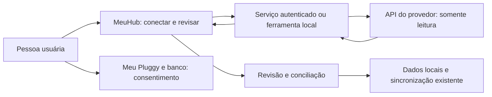

# Plano futuro — Open Finance no MeuHub

**Registro:** 18/11/2026

**Situação:** proposta para avaliação futura; nenhuma integração, conta, credencial ou conexão bancária foi criada por este plano.

**Objetivo:** consultar contas e lançamentos bancários próprios e oferecer importação revisável para Finanças, preservando dados existentes e o funcionamento local.

## Escopo e premissas

- Começar com **uso pessoal e somente leitura**: contas, saldos e transações disponibilizados pelo banco e pelo provedor. Não incluir pagamentos, Pix, transferências ou movimentação bancária.
- Candidato a avaliar: **Meu Pluggy + conector MeuPluggy**. Em 18/11/2026, a documentação do provedor informa uso pessoal gratuito, até cinco conexões e sem uso comercial. Isso não garante cobertura do banco, disponibilidade de todos os dados ou gratuidade de infraestrutura adicional. [Guia de uso pessoal](https://docs.pluggy.ai/pt/docs/guides/meu-pluggy-personal-use)
- O Open Finance exige consentimento do titular e autenticação na instituição transmissora. A experiência, o escopo, a duração e o cancelamento do consentimento devem seguir as condições do banco e do provedor. [Orientações do Banco Central](https://www.bcb.gov.br/estabilidadefinanceira/cliente-open-finance)
- Se o MeuHub passar a atender outras pessoas ou tiver uso comercial, reavaliar contrato, requisitos regulatórios, privacidade e orçamento. Em 18/11/2026, a Pluggy anunciava plano comercial de dados a partir de R$ 2.500/mês; condições podem mudar. [Planos e preços](https://www.pluggy.ai/precos)
- A importação CSV, os lançamentos manuais, os backups e a sincronização existentes continuam disponíveis. O usuário decide o que importar; nenhuma transação é incluída silenciosamente na primeira versão.

## Arquitetura candidata

O MeuHub é uma PWA local-first publicada como site estático, com Firebase para autenticação e sincronização. O acesso à API precisará de um serviço confiável ou de uma ferramenta local que proteja os segredos: uma página estática não é um lugar seguro para `CLIENT_SECRET`. A documentação da Pluggy descreve autenticação e leitura pelo servidor e o uso de token limitado no cliente. [Início rápido](https://docs.pluggy.ai/en/docs/quickstart)

**Decisão ainda aberta:** comparar serviço autenticado (por exemplo, função de backend protegida pelo Firebase Auth) com ferramenta local executada pela própria pessoa. Verificar hospedagem, cobrança, disponibilidade, proteção de segredos e compatibilidade com o fluxo pessoal do provedor antes de escolher. Dados compartilhados também passam pelo provedor; uso pessoal não significa processamento exclusivamente local.

## Etapas de implementação

- [ ] **OF0 — Confirmar viabilidade.** Conferir condições atuais do uso pessoal, quantidade de conexões, cobertura de cada banco e tipo de conta, dados disponíveis, limites de acesso, consentimento e renovação. Registrar custos de provedor e infraestrutura. **Aceite:** matriz banco × produto × cobertura e decisão informada sobre a arquitetura; ausência de cobertura tem alternativa CSV.
- [ ] **OF1 — Desenhar o fluxo e as regras de dados.** Definir conexão, seleção e associação explícita entre conta externa e conta MeuHub; decidir histórico inicial, periodicidade, dados salvos, comportamento de revogação e exclusão. Definir como tratar conta compartilhada, múltiplas contas, saldo inicial, transações pendentes, estornos e parcelas. **Aceite:** exemplos escritos de importação e reconciliação sem inflar o saldo; decisões pendentes registradas.
- [ ] **OF2 — Protótipo seguro com dados fictícios.** Implementar o menor serviço ou ferramenta escolhida com autenticação/autorização por usuário, segredos fora do repositório e do navegador, respostas limitadas ao necessário e tratamento de falhas. Usar sandbox e dados fictícios. **Aceite:** teste de acesso indevido e de erro; nenhum segredo ou dado financeiro em logs, código ou fixtures.
- [ ] **OF3 — Conexão e estado.** Integrar o fluxo de consentimento aplicável ao uso pessoal, apresentar instituição, conta, estado, última atualização, expiração ou necessidade de reconexão e instruções para revogar. **Aceite:** cancelamento e falhas não criam conta ou lançamento; o estado reflete o que o provedor efetivamente retorna.
- [ ] **OF4 — Associação e prévia.** Permitir associar uma conta externa a uma conta existente ou criar uma nova mediante escolha explícita. Apresentar origem, data, valor, descrição e status em prévia, com itens selecionáveis e possíveis duplicatas claramente identificadas. **Aceite:** consultar ou cancelar não altera o saldo nem cria lançamentos.
- [ ] **OF5 — Importação e conciliação.** Guardar identificadores estáveis e origem por conta/provedor quando disponíveis; projetar importação idempotente e detectar candidatos já importados por CSV ou manualmente sem excluir automaticamente lançamentos parecidos. Preservar categorias e edições locais; tratar alterações, exclusões, estornos e correções do provedor por regra explícita e revisão. **Aceite:** reimportar o mesmo período não duplica valores; itens realmente distintos de mesmo valor e data não são descartados; transferências e faturas não são contadas duas vezes.
- [ ] **OF6 — Saldo, offline e sincronização.** Decidir se o saldo bancário será referência separada ou como reconciliá-lo com o saldo calculado e o histórico existente. Mostrar data da última atualização e diferenças sem substituir valores locais automaticamente. Avaliar backup, migração, mescla em dois aparelhos e retomada após falha. **Aceite:** sem rede, dados locais seguem utilizáveis e ficam identificados como desatualizados; reconectar e repetir a operação não duplica dados.
- [ ] **OF7 — Privacidade, testes e documentação.** Documentar consentimento, dados recebidos e armazenados, proteção, retenção, revogação e remoção local/nuvem/provedor conforme as capacidades reais. Testar com sandbox: autenticação, isolamento entre usuários, concorrência, paginação, limite de requisições, indisponibilidade, reconexão, expiração, transações repetidas e restauração de backup. Atualizar README, especificação e arquitetura conforme o que for entregue. **Aceite:** testes passam, limitações ficam visíveis e uma revisão de segurança precede qualquer uso real.
- [ ] **OF8 — Validação pessoal controlada.** Depois das etapas anteriores, testar uma única conta própria com consentimento ativo, baixo volume e conferência manual dos valores; verificar revogação e recuperação. Ampliar apenas depois de revisar o resultado e os custos.

## Pontos para decidir antes da implementação

1. Quais bancos e produtos devem ser cobertos e se oferecem os dados necessários pelo conector pessoal?
2. Serviço hospedado ou ferramenta local? Qual custo e disponibilidade são aceitáveis?
3. Qual período inicial importar e qual frequência de atualização faz sentido?
4. Como conciliar saldo atual do banco, saldo inicial e histórico já registrado sem somar duas vezes?
5. Ao desconectar ou revogar, quais identificadores e lançamentos importados devem permanecer, e como excluí-los de cada local?
6. Como diferenciar transações pendentes, confirmadas, alteradas e estornadas, conforme os dados reais disponíveis?

## Fontes para revalidar antes de começar

- [Pluggy — uso pessoal e conector MeuPluggy](https://docs.pluggy.ai/pt/docs/guides/meu-pluggy-personal-use).
- [Pluggy — cobertura de conectores](https://v2.docs.pluggy.ai/pt/docs/connections/connectors-coverage).
- [Pluggy — autenticação e início rápido](https://docs.pluggy.ai/en/docs/quickstart).
- [Pluggy — planos e preços](https://www.pluggy.ai/precos).
- [Banco Central — Open Finance para clientes](https://www.bcb.gov.br/estabilidadefinanceira/cliente-open-finance).
